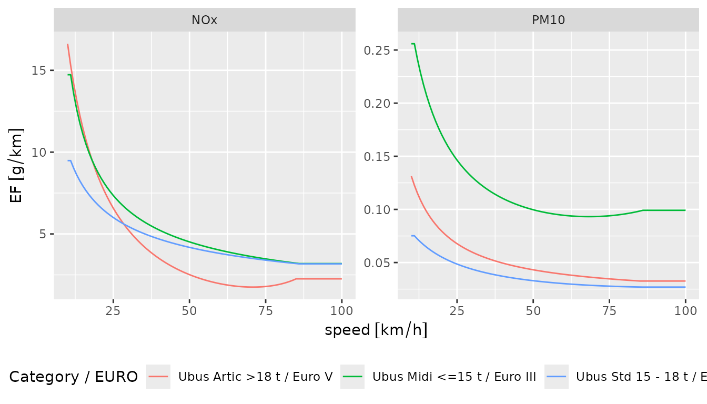
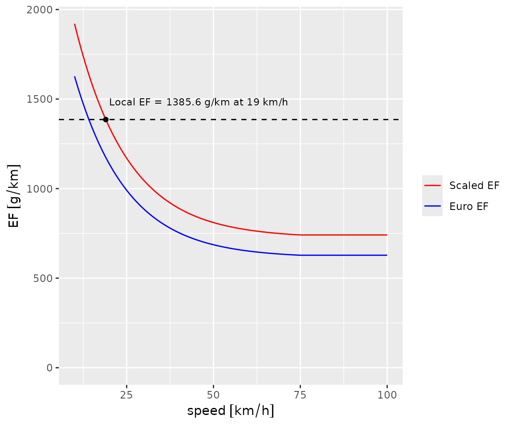

# Exploring Emission Factors

An emission factor (EF) is the mass of a pollutant a vehicle emits per
kilometre travelled (g/km). It depends on the vehicle’s characteristics
(type, age, fuel, technology) and, in most models, on its speed.
Environmental agencies estimate these relations from local measurements,
and the choice of model can change emission estimates considerably. This
vignette shows how to explore the emission factors available in
`gtfs2emis`.

## Available emission factor models

`gtfs2emis` includes hot-exhaust emission factors from four
environmental agencies. The links below lead to the agencies’ reports on
how the factors were derived.

**Hot-exhaust emissions**

- Brazil, Environmental Company of São Paulo:
  [CETESB](https://cetesb.sp.gov.br/veicular/)
- United States, Environmental Protection Agency:
  [MOVES3](https://www.epa.gov/moves)
- United States, California Air Resources Board:
  [EMFAC2017](https://arb.ca.gov/emfac/emissions-inventory)
- Europe, European Environment Agency:
  [EMEP/EEA](https://www.eea.europa.eu//publications/emep-eea-guidebook-2019)

**Wear emissions (tyre, brake and road wear)**

- Europe, European Environment Agency:
  [EMEP/EEA](https://www.eea.europa.eu//publications/emep-eea-guidebook-2019)

## Visualizing emission factor data

Emission factors depend on fleet characteristics (see the [fleet data
vignette](https://ipea.github.io/gtfs2emis/articles/gtfs2emis_fleet_data.html)).
In this section we use
[`ef_europe_emep()`](https://ipea.github.io/gtfs2emis/dev/reference/ef_europe_emep.md)
with three types of urban bus (Midi, Standard and Articulated) to show
how emission factors vary with vehicle type, speed and pollutant.

``` r

library(units)
library(gtfs2emis)
library(ggplot2)

ef_europe <- ef_europe_emep(speed = units::set_units(10:100, "km/h"),
                            veh_type = c("Ubus Midi <=15 t",
                                         "Ubus Std 15 - 18 t",
                                         "Ubus Artic >18 t"),
                            euro = c("III", "IV", "V"),
                            pollutant = c("PM10", "NOx"),
                            fuel = c("D", "D", "D"),
                            tech = c("-", "SCR", "SCR"),
                            as_list = TRUE)
names(ef_europe)
#>  [1] "pollutant" "veh_type"  "euro"      "fuel"      "tech"      "process"  
#>  [7] "slope"     "load"      "speed"     "EF"
```

With `as_list = TRUE`, the function returns a `list` with the emission
factors and the inputs used to compute them (see `names(ef_europe)`
above).
[`emis_to_dt()`](https://ipea.github.io/gtfs2emis/dev/reference/emis_to_dt.md)
turns it into a table, which is easier to inspect and plot:

``` r

ef_europe_dt <- emis_to_dt(emi_list = ef_europe,
                           emi_vars = "EF",
                           veh_vars = c("veh_type", "euro", "fuel", "tech"),
                           pol_vars = "pollutant",
                           segment_vars = c("slope", "load", "speed"))
head(ef_europe_dt)
#>            veh_type   euro   fuel   tech pollutant               EF     process
#>              <char> <char> <char> <char>    <char>          <units>      <char>
#> 1: Ubus Midi <=15 t    III      D      -      PM10 0.2559070 [g/km] hot_exhaust
#> 2: Ubus Midi <=15 t    III      D      -      PM10 0.2559070 [g/km] hot_exhaust
#> 3: Ubus Midi <=15 t    III      D      -      PM10 0.2413421 [g/km] hot_exhaust
#> 4: Ubus Midi <=15 t    III      D      -      PM10 0.2285624 [g/km] hot_exhaust
#> 5: Ubus Midi <=15 t    III      D      -      PM10 0.2172637 [g/km] hot_exhaust
#> 6: Ubus Midi <=15 t    III      D      -      PM10 0.2072074 [g/km] hot_exhaust
#>    slope  load     speed
#>    <num> <num>   <units>
#> 1:     0   0.5 10 [km/h]
#> 2:     0   0.5 11 [km/h]
#> 3:     0   0.5 12 [km/h]
#> 4:     0   0.5 13 [km/h]
#> 5:     0   0.5 14 [km/h]
#> 6:     0   0.5 15 [km/h]
```

The plot below shows how the emission factors change with speed for each
vehicle type (`veh_type`) and Euro standard (`euro`):

``` r

ef_europe_dt$name_fleet <- paste(ef_europe_dt$veh_type, "/ Euro", ef_europe_dt$euro)

# plot
ggplot(ef_europe_dt) +
  geom_line(aes(x = speed, y = EF, color = name_fleet)) +
  labs(color = "Category / EURO") +
  facet_wrap(~pollutant, scales = "free") +
  theme(legend.position = "bottom")
```



Sometimes the database has no emission factor for the exact combination
requested. In
[`ef_europe_emep()`](https://ipea.github.io/gtfs2emis/dev/reference/ef_europe_emep.md),
if the technology (`tech`) is not available for a given vehicle type,
Euro standard and pollutant, the function uses an available technology
instead and prints a message saying which one. In the example below,
there is no `CO2` factor for technology `"DPF+SCR"`. You can either
accept the substitution or choose a combination of `veh_type`, `euro`,
`tech` and `pollutant` that exists in the database.

``` r

ef_europe_co2 <- ef_europe_emep(speed = units::set_units(10:100, "km/h"),
                                veh_type = "Ubus Std 15 - 18 t",
                                euro = "VI",
                                pollutant = "CO2",
                                tech = "DPF+SCR",
                                as_list = TRUE)
#> "CO2" emission factor not found for technology "DPF+SCR" and Euro "VI".
#> ℹ The package assumed 'SCR' Technology entry. Check `data(ef_europe_emep_db)`
#>   for available data.
```

The other EF functions,
[`ef_usa_emfac()`](https://ipea.github.io/gtfs2emis/dev/reference/ef_usa_emfac.md),
[`ef_usa_moves()`](https://ipea.github.io/gtfs2emis/dev/reference/ef_usa_moves.md)
and
[`ef_brazil_cetesb()`](https://ipea.github.io/gtfs2emis/dev/reference/ef_brazil_cetesb.md),
work in a similar way. See their documentation for details.

### Scaling emission factors: making local factors speed-dependent

The MOVES3, EMEP/EEA and EMFAC2017 emission factors depend on speed. The
CETESB factors for Brazil
([`ef_brazil_cetesb()`](https://ipea.github.io/gtfs2emis/dev/reference/ef_brazil_cetesb.md))
do not. With
[`ef_scaled_euro()`](https://ipea.github.io/gtfs2emis/dev/reference/ef_scaled_euro.md),
you can scale a local emission factor so that it varies with speed in
the same way as the EMEP/EEA factor:

``` math
EF_{scaled} (V) = EF_{local} \times \frac{EF_{euro}(V)}{EF_{euro}(SDC)},
```

where $`EF_{scaled}(V)`$ is the scaled emission factor at speed $`V`$,
$`EF_{local}`$ is the local emission factor, and $`EF_{euro}(V)`$ and
$`EF_{euro}(SDC)`$ are the EMEP/EEA emission factors at speed $`V`$ and
at the average urban driving speed $`SDC`$ (19 km/h by default). With
the default flat road and load of 0.5, the scaled factor equals the
local one at $`V = SDC`$.

To see this, we compare $`EF_{local}`$, $`EF_{scaled}(V)`$ and the
reference $`EF_{euro}(V)`$ in five steps:

1.  Build a fleet `data.frame` that matches each vehicle in the local
    model to a vehicle in the European model

``` r

fleet_filepath <- system.file("extdata/bra_cur_fleet.txt", package = "gtfs2emis")
cur_fleet <- read.table(fleet_filepath, header = TRUE, sep = ",", nrows = 1)
cur_fleet
#>   year euro shape_id type_name_br           veh_type total fuel
#> 1 2006  III     1849  BUS_URBAN_D Ubus Std 15 - 18 t     2    D
```

2.  Estimate local emission factors

``` r

cur_local_ef <- ef_brazil_cetesb(pollutant = "CO2",
                                 veh_type = cur_fleet$type_name_br,
                                 model_year = cur_fleet$year)
head(cur_local_ef)
#> $pollutant
#> [1] "CO2"
#> 
#> $veh_type
#> [1] "BUS_URBAN_D"
#> 
#> $model_year
#> [1] 2006
#> 
#> $EF
#> Units: [g/km]
#>      CO2_2006
#> [1,] 1385.626
#> 
#> $process
#> [1] "hot_exhaust"

# convert local EF to data.frame
cur_local_ef_dt <- emis_to_dt(emi_list = cur_local_ef,
                              emi_vars = "EF")
```

3.  Estimate the European emission factors with
    [`ef_europe_emep()`](https://ipea.github.io/gtfs2emis/dev/reference/ef_europe_emep.md)

``` r

# Euro EF
cur_euro_ef <- ef_europe_emep(speed = units::set_units(10:100, "km/h"),
                              veh_type = cur_fleet$veh_type,
                              euro = cur_fleet$euro,
                              pollutant = "CO2",
                              tech = "-")

# convert to data.frame
cur_euro_ef_dt <- emis_to_dt(emi_list = cur_euro_ef,
                             emi_vars = "EF",
                             veh_vars = c("veh_type", "euro", "fuel", "tech"),
                             segment_vars = "speed")
cur_euro_ef_dt$source <- "Euro EF"
```

4.  Apply
    [`ef_scaled_euro()`](https://ipea.github.io/gtfs2emis/dev/reference/ef_scaled_euro.md)

``` r

cur_scaled_ef <- ef_scaled_euro(ef_local = cur_local_ef$EF,
                                speed = units::set_units(10:100, "km/h"),
                                veh_type = cur_fleet$veh_type,
                                euro = cur_fleet$euro,
                                pollutant = "CO2",
                                tech = "-")

# convert to data.frame
cur_scaled_ef_dt <- emis_to_dt(emi_list = cur_scaled_ef,
                               emi_vars = "EF",
                               veh_vars = c("veh_type", "euro", "fuel", "tech"),
                               segment_vars = "speed")
cur_scaled_ef_dt$source <- "Scaled EF"
```

5.  Plot the three emission factors

``` r

# rbind data
cur_ef <- rbind(cur_euro_ef_dt, cur_scaled_ef_dt)
cur_ef$source <- factor(cur_ef$source, levels = c("Scaled EF", "Euro EF"))

# plot
ggplot() +
  # add scaled and Euro EF
  geom_line(data = cur_ef,
            aes(x = speed, y = EF, group = source, color = source)) +
  # add local EF
  geom_hline(aes(yintercept = cur_local_ef_dt$EF),
             colour = "black", linetype = "dashed") +
  geom_point(aes(x = units::set_units(19, "km/h"), y = cur_local_ef$EF)) +
  # add local EF text
  geom_text(aes(x = units::set_units(19, "km/h"), y = cur_local_ef_dt$EF),
            label = sprintf("Local EF = %s g/km at 19 km/h", round(cur_local_ef_dt$EF, 1)),
            hjust = 0, nudge_y = 100, nudge_x = 1,
            size = 3, fontface = 1) +
  # plot settings
  scale_color_manual(values = c("red", "blue")) +
  coord_cartesian(ylim = c(0, max(cur_scaled_ef_dt$EF))) +
  labs(color = NULL)
```



The scaled EF equals the local EF (dashed line) at 19 km/h and follows
the same speed curve as the Euro EF.

## Emission factor databases in `gtfs2emis`

The hot-exhaust emission factor databases included in the package can be
loaded with:

- `data(ef_brazil_cetesb_db)` from Environmental Company of São Paulo,
  Brazil (CETESB)
- `data(ef_usa_moves_db)` from MOtor Vehicle Emission Simulator (MOVES)
- `data(ef_usa_emfac_db)` from California Air Resources Board (EMFAC
  Model)
- `data(ef_europe_emep_db)` from European Environment Agency (EMEP/EEA)

These data were downloaded from the agencies’ websites and software and
pre-processed for the emission factor functions. The processing scripts
are in the [gtfs2emis GitHub
repository](https://github.com/ipea/gtfs2emis/tree/master/data-raw).

## Learn more

Check out our other guide:

- [Exploring Non-Exhaust Emission
  Factors](https://ipea.github.io/gtfs2emis/articles/gtfs2emis_non_exhaust_ef.html)

## Report a bug

If you have any suggestions or want to report an error, please visit
[the package GitHub page](https://github.com/ipea/gtfs2emis/issues).
