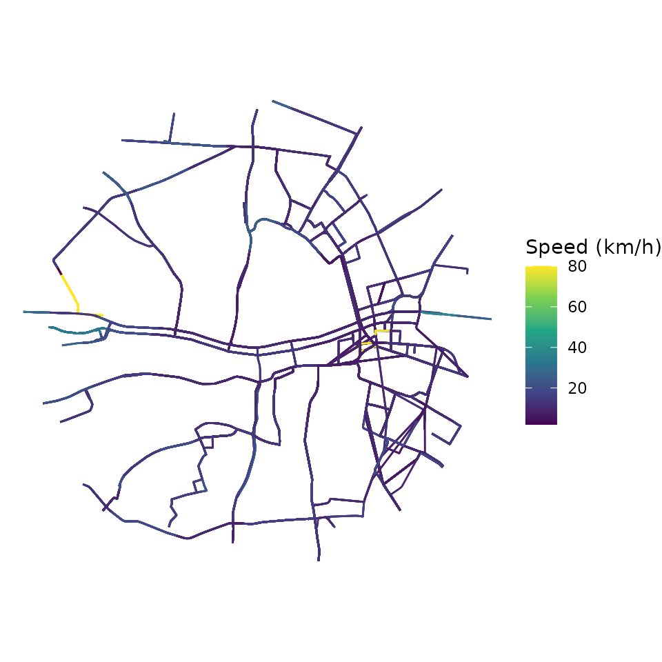
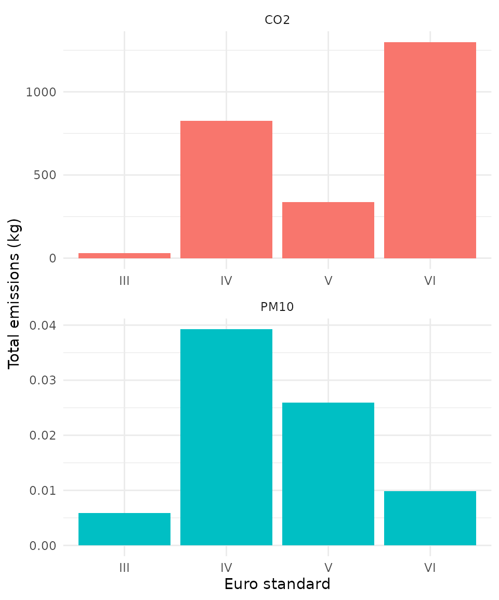
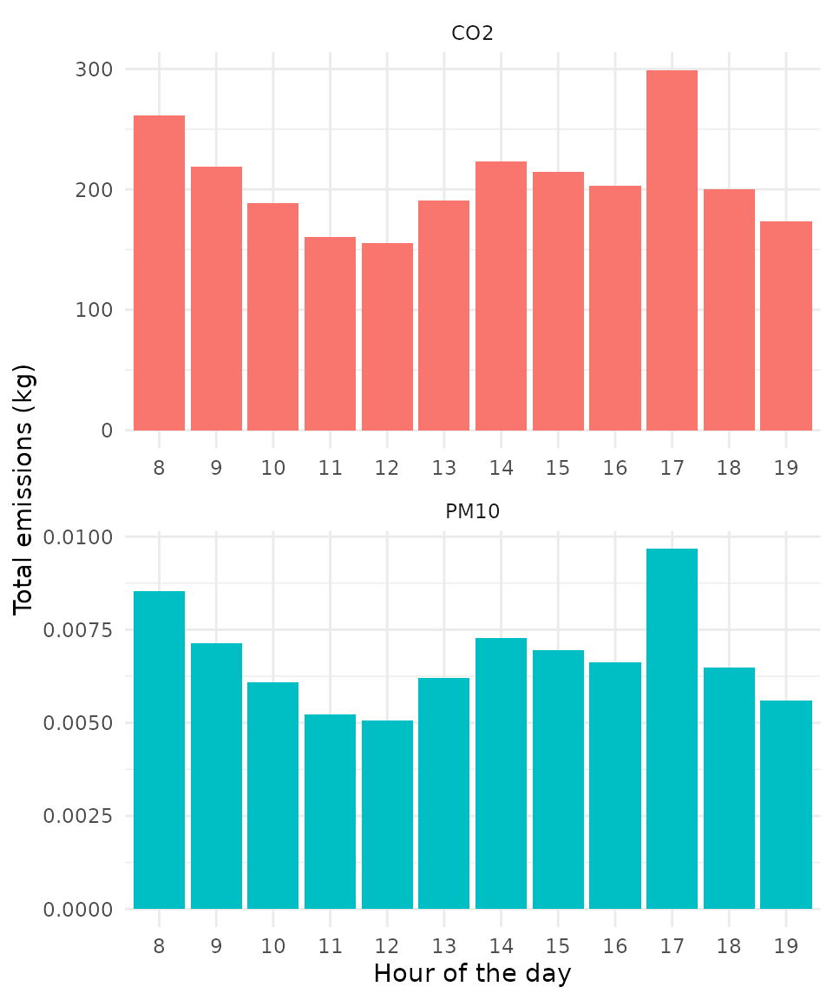
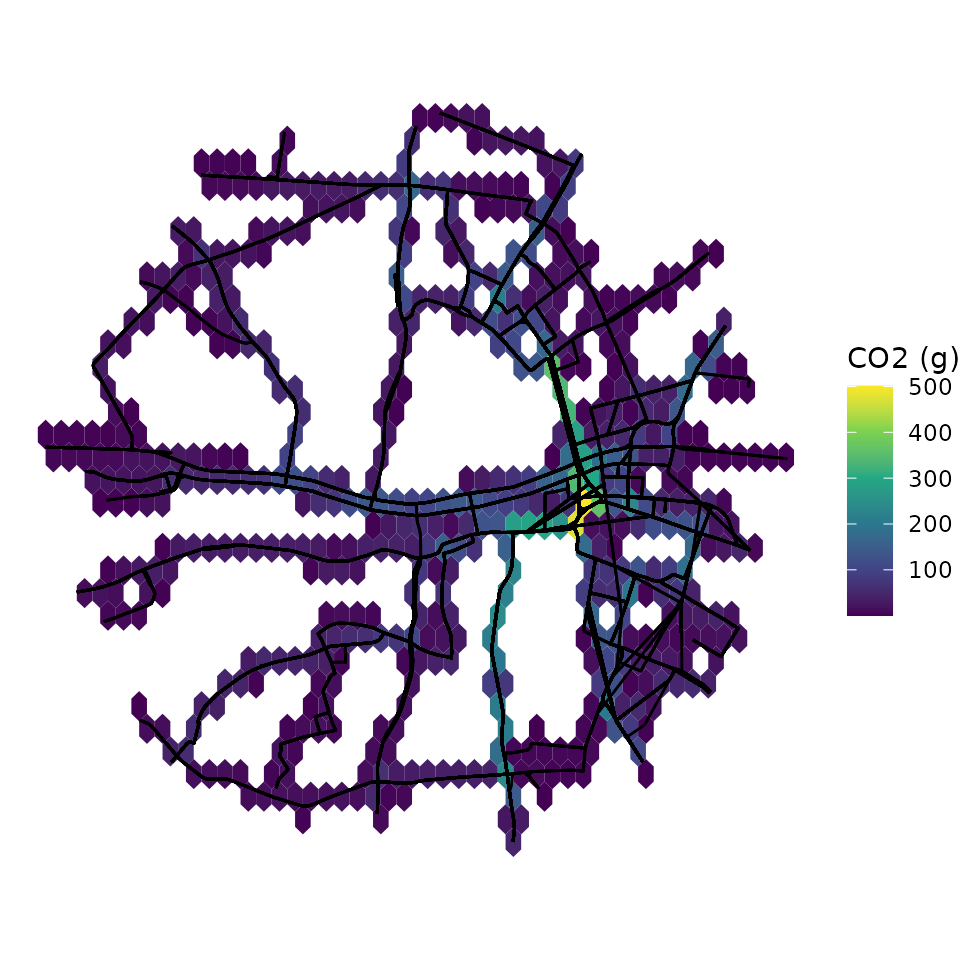

# Getting started

Abstract

`gtfs2emis` is an R package to estimate public transport emissions using
data in the General Transit Feed Specification (GTFS) format. The
package allows users to estimate the emission levels of several types of
pollutants for each public transport vehicle/trip/route at high spatial
and temporal resolutions simply using a GTFS feed and some information
on fleet characteristics.

## 1. Introduction

This vignette introduces the main functions of `gtfs2emis` and walks
through a reproducible example: from a GTFS feed and a fleet table to
hot-exhaust emission estimates summarised by pollutant, vehicle, hour of
the day and space.

## 2. Installation

One can install `gtfs2emis` from CRAN, or the development version from
GitHub:

``` r

# From CRAN
install.packages("gtfs2emis")

# Dev. version with latest features
# install.packages("remotes")
remotes::install_github("ipea/gtfs2emis")
```

The package ships with small sample GTFS feeds and fleet files:

``` r

data_path <- system.file("extdata", package = "gtfs2emis")
list.files(data_path)
#> [1] "bra_cur_fleet.txt" "bra_cur_gtfs.zip"  "bra_cur-srtm.tif" 
#> [4] "irl_dub_fleet.txt" "irl_dub_gtfs.zip"  "usa_det_fleet.txt"
#> [7] "usa_det_gtfs.zip"
```

- Subset of Curitiba (Brazil): `bra_cur_gtfs.zip` and
  `bra_cur_fleet.txt`
- Subset of Dublin (Ireland): `irl_dub_gtfs.zip` and `irl_dub_fleet.txt`
- Subset of Detroit (US): `usa_det_gtfs.zip` and `usa_det_fleet.txt`

## 3. Data requirements

To estimate the emissions of a public transport system, you need:

1.  A GTFS feed (a `.zip` file or a `gtfs` object read with
    [`gtfstools::read_gtfs()`](https://ipea.github.io/gtfstools/reference/read_gtfs.html)).
2.  A `data.frame` describing the fleet (for example vehicle type, age
    or Euro standard, and fuel).
3.  The choice of an emission factor model. The package includes models
    for Europe (EMEP/EEA), Brazil (CETESB) and the US (MOVES and EMFAC).
4.  The choice of which pollutants to estimate. The pollutants available
    depend on the emission factor model.

## 4. Package Overview

Before we start, let’s load a few packages we’ll be using in this
vignette:

``` r

library(gtfs2emis)
library(gtfstools)
library(data.table)
library(ggplot2)
library(units)
library(sf)
```

The `gtfs2emis` package has two core functions:

1.  [`transport_model()`](https://ipea.github.io/gtfs2emis/dev/reference/transport_model.md)
    converts GTFS data into an `sf` object of road segments between
    consecutive stops, with the distance, speed and time of each vehicle
    trip.
2.  [`emission_model()`](https://ipea.github.io/gtfs2emis/dev/reference/emission_model.md)
    estimates hot-exhaust emissions from four inputs:
    1.  the output of
        [`transport_model()`](https://ipea.github.io/gtfs2emis/dev/reference/transport_model.md);
    2.  the name of the emission factor model;
    3.  the pollutants to estimate; and
    4.  a `data.frame` with the fleet characteristics. It returns a
        `list` with the emissions of each pollutant and the inputs used
        to compute them.

Three functions help you analyze the output of
[`emission_model()`](https://ipea.github.io/gtfs2emis/dev/reference/emission_model.md):

- [`emis_summary()`](https://ipea.github.io/gtfs2emis/dev/reference/emis_summary.md)
  to aggregate emission estimates by pollutant, vehicle characteristics
  or hour of the day.
- [`emis_grid()`](https://ipea.github.io/gtfs2emis/dev/reference/emis_grid.md)
  to spatially aggregate emission estimates using any custom spatial
  grid or polygons.
- [`emis_to_dt()`](https://ipea.github.io/gtfs2emis/dev/reference/emis_to_dt.md)
  to convert the output of
  [`emission_model()`](https://ipea.github.io/gtfs2emis/dev/reference/emission_model.md)
  from `list` to `data.table`.

## 5. Demonstration of sample data

This example uses mostly default parameters and assumes that the fleet
is evenly distributed across all routes. Two other vignettes go further:
one on [emission
factors](https://ipea.github.io/gtfs2emis/articles/gtfs2emis_emission_factor.html)
and one on how to build the [fleet
data](https://ipea.github.io/gtfs2emis/articles/gtfs2emis_fleet_data.html).

We use a small sample of data for Dublin, Ireland, and estimate `CO2`
and `PM10` emissions of bus services on weekdays.

### 5.1 Transport model

The first step is to build the transport model with
[`transport_model()`](https://ipea.github.io/gtfs2emis/dev/reference/transport_model.md).
It takes either the path to a GTFS `.zip` file or a `gtfs` object read
with
[`gtfstools::read_gtfs()`](https://ipea.github.io/gtfstools/reference/read_gtfs.html),
and returns an `sf` object of road segments with their speeds, distances
and times. This is the input
[`emission_model()`](https://ipea.github.io/gtfs2emis/dev/reference/emission_model.md)
needs.

First, let’s read the GTFS data and keep only the services that run on
weekdays.

``` r

# path to GTFS.zip file
gtfs_file <- system.file("extdata/irl_dub_gtfs.zip", package = "gtfs2emis")

# read GTFS
gtfs <- gtfstools::read_gtfs(gtfs_file)

# keep weekday services (drop Saturday and Sunday)
gtfs <- gtfstools::filter_by_weekday(gtfs,
                                     weekday = c("saturday", "sunday"),
                                     keep = FALSE)
```

Now let’s build the transport model. This is the slowest step.

``` r

# generate transport model
tp_model <- transport_model(gtfs_data = gtfs,
                            min_speed = 2,
                            max_speed = 80,
                            spatial_resolution = 100)

head(tp_model)
#> Simple feature collection with 6 features and 14 fields
#> Geometry type: LINESTRING
#> Dimension:     XY
#> Bounding box:  xmin: -6.265914 ymin: 53.34591 xmax: -6.25602 ymax: 53.36229
#> Geodetic CRS:  WGS 84
#>         shape_id               trip_id route_type timestamp stop_sequence
#> 1 60-1-b12-1.1.O 6264.2.60-1-b12-1.1.O          3  13:00:56            18
#> 2 60-1-b12-1.1.O 6264.2.60-1-b12-1.1.O          3  13:02:33            19
#> 3 60-1-b12-1.1.O 6264.2.60-1-b12-1.1.O          3  13:04:02            20
#> 4 60-1-b12-1.1.O 6264.2.60-1-b12-1.1.O          3  13:04:51            21
#> 5 60-1-b12-1.1.O 6264.2.60-1-b12-1.1.O          3  13:07:39            22
#> 6 60-1-b12-1.1.O 6264.2.60-1-b12-1.1.O          3  13:10:01            23
#>           speed          dist      cumdist     cumtime trip_number from_stop_id
#> 1 10.629 [km/h] 0.286389 [km]  286.389 [m]  96.999 [s]           1 8220DB000048
#> 2 11.740 [km/h] 0.290229 [km]  576.618 [m] 185.996 [s]           1 8220DB000049
#> 3 11.517 [km/h] 0.156762 [km]  733.380 [m] 234.997 [s]           1 8220DB000051
#> 4 12.184 [km/h] 0.568572 [km] 1301.952 [m] 402.992 [s]           1 8220DB000052
#> 5 14.175 [km/h] 0.559136 [km] 1861.088 [m] 544.995 [s]           1 8220DB000265
#> 6 11.473 [km/h] 0.427037 [km] 2288.125 [m] 678.991 [s]           1 8220DB000271
#>     to_stop_id from_timestamp to_timestamp                       geometry
#> 1 8220DB000049       13:00:56     13:02:33 LINESTRING (-6.258882 53.36...
#> 2 8220DB000051       13:02:33     13:04:02 LINESTRING (-6.260943 53.36...
#> 3 8220DB000052       13:04:02     13:04:51 LINESTRING (-6.263389 53.35...
#> 4 8220DB000265       13:04:51     13:07:39 LINESTRING (-6.26464 53.356...
#> 5 8220DB000271       13:07:39     13:10:01 LINESTRING (-6.262147 53.35...
#> 6 8220DB000340       13:10:01     13:12:15 LINESTRING (-6.25953 53.348...
```

Each row of the output is one segment of one trip, stored as an `sf`
LINESTRING with its distance, speed and timestamp. The map below shows
the average speed on each segment.

``` r

ggplot(data = tp_model) +
  geom_sf(aes(color = as.numeric(speed))) +
  scale_color_continuous(type = "viridis") +
  labs(color = "Speed (km/h)") +
  theme_void()
```



### 5.2 Fleet data

The next step is to prepare a `data.frame` describing the fleet. It can
be either:

- a **simple** table with the overall composition of the fleet, in which
  case `gtfs2emis` assumes the fleet is evenly distributed across all
  routes; or
- a **detailed** table that also says which vehicles run on which routes
  (`shape_id`s); see the [fleet data
  vignette](https://ipea.github.io/gtfs2emis/articles/gtfs2emis_fleet_data.html)
  for how to use it.

Here we use a simple table with the share of Dublin buses
(`fleet_composition`) by vehicle type, Euro standard, technology and
fuel:

``` r

fleet_file <- system.file("extdata/irl_dub_fleet.txt", package = "gtfs2emis")
fleet_df <- read.csv(fleet_file)
head(fleet_df)
#>             veh_type euro fuel   N fleet_composition    tech
#> 1 Ubus Std 15 - 18 t  III    D  10        0.00998004       -
#> 2 Ubus Std 15 - 18 t   IV    D 296        0.29540918     SCR
#> 3 Ubus Std 15 - 18 t    V    D 148        0.14770459     SCR
#> 4 Ubus Std 15 - 18 t   VI    D 548        0.54690619 DPF+SCR
```

The columns required depend on the emission factor model. The EMEP/EEA
model used here needs vehicle type, Euro standard, technology and fuel.
The [fleet data
vignette](https://ipea.github.io/gtfs2emis/articles/gtfs2emis_fleet_data.html)
lists the columns each model requires.

### 5.3 Emission model

Finally,
[`emission_model()`](https://ipea.github.io/gtfs2emis/dev/reference/emission_model.md)
estimates the hot-exhaust emissions. It takes the output of
[`transport_model()`](https://ipea.github.io/gtfs2emis/dev/reference/transport_model.md),
the fleet data, the emission factor model and the pollutants. It returns
a `list` that includes:

- the emissions (`emi`) and emission factors (`EF`);
- the vehicle variables (`veh_type`, `euro`, `fuel`, `tech`,
  `fleet_composition`);
- the travel variables (`slope`, `load`, `speed`) and the transport
  model itself (`tp_model`).

``` r

emi_list <- emission_model(tp_model = tp_model,
                           ef_model = "ef_europe_emep",
                           fleet_data = fleet_df,
                           pollutant = c("CO2", "PM10"))

names(emi_list)
#>  [1] "pollutant"         "veh_type"          "euro"             
#>  [4] "fuel"              "tech"              "process"          
#>  [7] "slope"             "load"              "speed"            
#> [10] "EF"                "emi"               "tp_model"         
#> [13] "fleet_composition"
```

## 6. Analyzing emission estimates

A long list can be awkward to work with.
[`emis_to_dt()`](https://ipea.github.io/gtfs2emis/dev/reference/emis_to_dt.md)
converts the output of
[`emission_model()`](https://ipea.github.io/gtfs2emis/dev/reference/emission_model.md)
into a `data.table`:

``` r

emi_dt <- emis_to_dt(emi_list = emi_list,
                     veh_vars = c("veh_type", "euro", "fuel"),
                     pol_vars = "pollutant")

head(emi_dt)
#>              veh_type   euro   fuel pollutant          emi     process
#>                <char> <char> <char>    <char>      <units>      <char>
#> 1: Ubus Std 15 - 18 t    III      D       CO2 4.465973 [g] hot_exhaust
#> 2: Ubus Std 15 - 18 t    III      D       CO2 4.350604 [g] hot_exhaust
#> 3: Ubus Std 15 - 18 t    III      D       CO2 2.349901 [g] hot_exhaust
#> 4: Ubus Std 15 - 18 t    III      D       CO2 8.523034 [g] hot_exhaust
#> 5: Ubus Std 15 - 18 t    III      D       CO2 7.769609 [g] hot_exhaust
#> 6: Ubus Std 15 - 18 t    III      D       CO2 6.659250 [g] hot_exhaust
```

[`emis_summary()`](https://ipea.github.io/gtfs2emis/dev/reference/emis_summary.md)
aggregates emissions by pollutant, vehicle characteristics or hour of
the day (`by = "pollutant"`, `"vehicle"` or `"time"`).

### 6.1 Total emissions by pollutant

``` r

emi_by_pol <- emis_summary(emi_list = emi_list,
                           by = "pollutant")
emi_by_pol
#>    pollutant     process              emi
#>       <char>      <char>          <units>
#> 1:       CO2 hot_exhaust 2.489907e+06 [g]
#> 2:      PM10 hot_exhaust 8.089189e+01 [g]
```

### 6.2 Total emissions by vehicle type

With `by = "vehicle"`, emissions are aggregated by vehicle type (the
default, `veh_vars = "veh_type"`):

``` r

emi_by_veh <- emis_summary(emi_list = emi_list,
                           by = "vehicle")
head(emi_by_veh)
#>              veh_type pollutant     process              emi
#>                <char>    <char>      <char>          <units>
#> 1: Ubus Std 15 - 18 t       CO2 hot_exhaust 2.489907e+06 [g]
#> 2: Ubus Std 15 - 18 t      PM10 hot_exhaust 8.089189e+01 [g]
```

Use `veh_vars` to aggregate by other vehicle characteristics, such as
the Euro standard:

``` r

emi_by_veh <- emis_summary(emi_list = emi_list,
                           by = "vehicle",
                           veh_vars = c("veh_type", "euro"))
head(emi_by_veh)
#>              veh_type   euro pollutant     process              emi
#>                <char> <char>    <char>      <char>          <units>
#> 1: Ubus Std 15 - 18 t    III       CO2 hot_exhaust 2.897499e+04 [g]
#> 2: Ubus Std 15 - 18 t     IV       CO2 hot_exhaust 8.242787e+05 [g]
#> 3: Ubus Std 15 - 18 t      V       CO2 hot_exhaust 3.372472e+05 [g]
#> 4: Ubus Std 15 - 18 t     VI       CO2 hot_exhaust 1.299406e+06 [g]
#> 5: Ubus Std 15 - 18 t    III      PM10 hot_exhaust 5.894953e+00 [g]
#> 6: Ubus Std 15 - 18 t     IV      PM10 hot_exhaust 3.923958e+01 [g]

# plot
ggplot(data = emi_by_veh) +
  geom_col(aes(x = euro, y = as.numeric(emi / 1000), fill = pollutant),
           color = NA, show.legend = FALSE) +
  labs(y = "Total emissions (kg)", x = "Euro standard") +
  facet_wrap(~pollutant, scales = "free", nrow = 2) +
  theme_minimal()
```



### 6.3 Total emissions by time of the day

``` r

emi_by_time <- emis_summary(emi_list = emi_list,
                            by = "time")
head(emi_by_time)
#>    timestamp_hour pollutant     process              emi
#>             <int>    <char>      <char>          <units>
#> 1:              8       CO2 hot_exhaust 2.617006e+05 [g]
#> 2:              8      PM10 hot_exhaust 8.535500e+00 [g]
#> 3:              9       CO2 hot_exhaust 2.190031e+05 [g]
#> 4:              9      PM10 hot_exhaust 7.147041e+00 [g]
#> 5:             10       CO2 hot_exhaust 1.883914e+05 [g]
#> 6:             10      PM10 hot_exhaust 6.098727e+00 [g]

# plot
ggplot(data = emi_by_time) +
  geom_col(aes(x = factor(timestamp_hour), y = as.numeric(emi / 1000), fill = pollutant),
           color = NA, show.legend = FALSE) +
  labs(y = "Total emissions (kg)", x = "Hour of the day") +
  facet_wrap(~pollutant, scales = "free", nrow = 2) +
  theme_minimal()
```



### 6.4 Spatial distribution of emissions

Finally,
[`emis_grid()`](https://ipea.github.io/gtfs2emis/dev/reference/emis_grid.md)
aggregates emissions over any set of polygons (an `sf` POLYGON object),
such as a grid or neighbourhoods.

Let’s create a regular hexagonal grid:

``` r

# create spatial grid
mygrid <- sf::st_make_grid(x = sf::st_make_valid(emi_list$tp_model),
                           cellsize = 0.25 / 200,
                           crs = 4326,
                           what = "polygons",
                           square = FALSE)

ggplot() +
  geom_sf(data = mygrid) +
  theme_void()
```


Then aggregate the daily emissions on it. The output has one column per
pollutant and fleet category (for example `CO2_Euro_III`); here we map
`CO2` from Euro III buses.

``` r

mygrid_emi <- emis_grid(emi_list,
                        grid = mygrid,
                        time_resolution = "day",
                        quiet = FALSE)

ggplot() +
  geom_sf(data = mygrid_emi, aes(fill = as.numeric(CO2_Euro_III)), color = NA) +
  geom_sf(data = emi_list$tp_model$geometry, color = "black") +
  scale_fill_continuous(type = "viridis") +
  labs(fill = "CO2 (g)") +
  theme_void()
```



### Learn more

Check out our extra guides:

- [Defining Fleet
  data](https://ipea.github.io/gtfs2emis/articles/gtfs2emis_fleet_data.html)
- [Exploring Emission
  Factors](https://ipea.github.io/gtfs2emis/articles/gtfs2emis_emission_factor.html)
- [Exploring Non-Exhaust Emission
  Factors](https://ipea.github.io/gtfs2emis/articles/gtfs2emis_non_exhaust_ef.html)

### Report a bug

If you have any suggestions or want to report an error, please visit
[the package GitHub page](https://github.com/ipea/gtfs2emis/issues).
