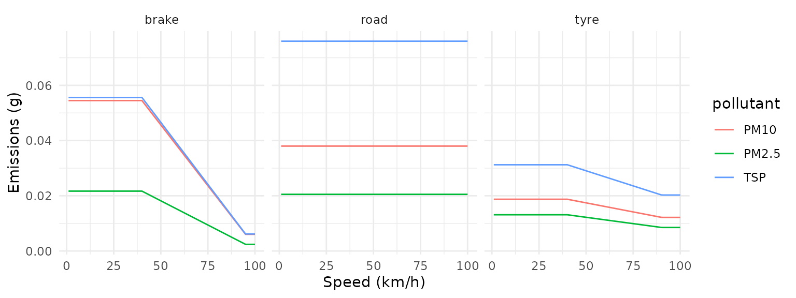
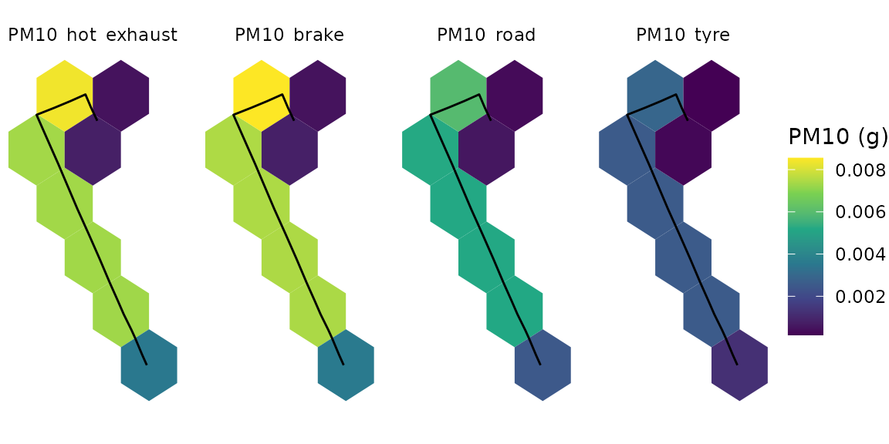
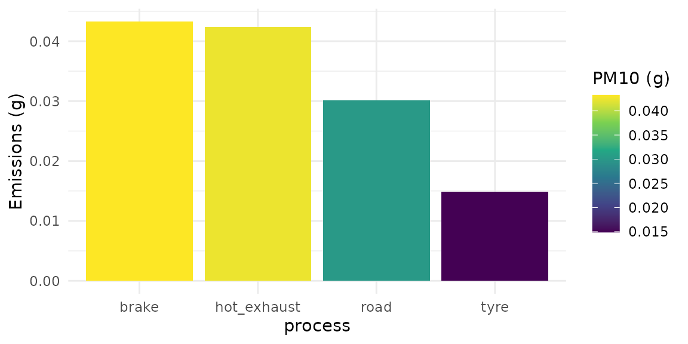

# Exploring Non-Exhaust Emission Factors

Vehicles also emit particles from processes other than combustion: tyre,
brake and road surface wear. An emissions inventory for particulate
matter should include them. `gtfs2emis` implements the non-exhaust
methods of the [EMEP/EEA
guidebook](https://www.eea.europa.eu//publications/emep-eea-guidebook-2019)
in
[`emi_europe_emep_wear()`](https://ipea.github.io/gtfs2emis/dev/reference/emi_europe_emep_wear.md).

Tyre and brake wear emissions are computed as:

``` math
 TE(i) = dist \times EF_{tsp}(j) \times mf_s(i) \times SC(speed)
```

where:

- $`TE(i)`$ = total emissions of pollutant $`i`$ (g),
- $`dist`$ = distance driven by each vehicle (km),
- $`EF_{tsp}(j)`$ = TSP (Total Suspended Particle) mass emission factor
  for vehicles of category $`j`$ (g/km),
- $`mf_s(i)`$ = mass fraction of TSP that can be attributed to pollutant
  $`i`$,
- $`SC(speed)`$ = correction factor for a mean vehicle travelling at a
  given speed (-).

## Tyre

For heavy-duty vehicles such as buses, the tyre-wear emission factor
accounts for vehicle size (number of axles) and load:

``` math
EFTSP^{hdv}_{tyre} = 0.5 \times N_{axle} \times LCF_{tyre} \times EFTSP^{pc}_{tyre}
```

where:

- $`EFTSP^{hdv}_{tyre}`$ = TSP emission factor for tyre wear from
  heavy-duty vehicles (g/km),
- $`N_{axle}`$ = number of vehicle axles (-),
- $`LCF_{tyre}`$ = a load correction factor for tyre wear (-),
- $`EFTSP^{pc}_{tyre}`$ = TSP emission factor for tyre wear from
  passenger car vehicles, 0.0107 g/km.

and
``` math
LCF_{tyre} = 1.41 + (1.38 \times LF)
```

where:

- $`LF`$ = load factor (-), ranging from 0 for an empty bus to 1 for a
  fully laden one.

The function uses the following number of axles for each vehicle class:

| vehicle class (j)    | number of axles |
|----------------------|-----------------|
| Ubus Midi \<=15 t    | 2               |
| Ubus Std 15 - 18 t   | 2               |
| Ubus Artic \>18 t    | 3               |
| Coaches Std \<=18 t  | 2               |
| Coaches Artic \>18 t | 3               |

The size distribution of tyre wear particles is:

| particle size class (i) | mass fraction of TSP |
|-------------------------|----------------------|
| TSP                     | 1.000                |
| PM10                    | 0.600                |
| PM2.5                   | 0.420                |
| PM1.0                   | 0.060                |
| PM0.1                   | 0.048                |

Finally, the speed correction is:

- $`SC_{tyre}(speed) = 1.39`$, when $`speed < 40`$ km/h;
- $`SC_{tyre}(speed) = -0.00974 \times speed + 1.78`$, when
  $`40 \le speed \le 90`$ km/h;
- $`SC_{tyre}(speed) = 0.902`$, when $`speed > 90`$ km/h.

In
[`emi_europe_emep_wear()`](https://ipea.github.io/gtfs2emis/dev/reference/emi_europe_emep_wear.md),
this process is selected with `process = "tyre"`:

``` r

library(gtfs2emis)

emi_europe_emep_wear(dist = units::set_units(1, "km"),
                     speed = units::set_units(30, "km/h"),
                     pollutant = c("PM10", "TSP", "PM2.5"),
                     veh_type = "Ubus Std 15 - 18 t",
                     fleet_composition = 1,
                     load = 0.5,
                     process = "tyre",
                     as_list = TRUE)
#> $pollutant
#> [1] "PM10"  "TSP"   "PM2.5"
#> 
#> $veh_type
#> [1] "Ubus Std 15 - 18 t"
#> 
#> $fleet_composition
#> [1] 1
#> 
#> $speed
#> 30 [km/h]
#> 
#> $dist
#> 1 [km]
#> 
#> $emi
#>    PM10_tyre_veh_1 TSP_tyre_veh_1 PM2.5_tyre_veh_1
#>            <units>        <units>          <units>
#> 1:  0.01873998 [g]  0.0312333 [g]   0.01311799 [g]
#> 
#> $process
#> [1] "tyre"
```

## Brake

The heavy-duty vehicle emission factor is the passenger car factor,
adjusted to match measurements from heavy-duty vehicles:

``` math
EFTSP^{hdv}_{brake} = 1.956 \times LCF_{brake} \times EFTSP^{pc}_{brake}
```

where:

- $`EFTSP^{hdv}_{brake}`$ = heavy-duty vehicle emission factor for TSP,
- $`LCF_{brake}`$ = load correction factor for brake wear,
- $`EFTSP^{pc}_{brake}`$ = passenger car emission factor for TSP, 0.0122
  g/km.

``` math
LCF_{brake} = 1 + (0.79 \times LF),
```

where:

- $`LF`$ = load factor (-), ranging from 0 for an empty bus to 1 for a
  fully laden one.

The size distribution of brake wear particles is:

| particle size class (i) | mass fraction of TSP |
|-------------------------|----------------------|
| TSP                     | 1.000                |
| PM10                    | 0.980                |
| PM2.5                   | 0.390                |
| PM1.0                   | 0.100                |
| PM0.1                   | 0.080                |

Finally, the speed correction is:

- $`SC_{brake}(speed) = 1.67`$, when $`speed < 40`$ km/h;
- $`SC_{brake}(speed) = -0.0270 \times speed + 2.75`$, when
  $`40 \le speed \le 95`$ km/h;
- $`SC_{brake}(speed) = 0.185`$, when $`speed > 95`$ km/h.

``` r

emi_europe_emep_wear(dist = units::set_units(1, "km"),
                     speed = units::set_units(30, "km/h"),
                     pollutant = c("PM10", "TSP", "PM2.5"),
                     veh_type = "Ubus Std 15 - 18 t",
                     fleet_composition = 1,
                     load = 0.5,
                     process = "brake",
                     as_list = TRUE)
#> $pollutant
#> [1] "PM10"  "TSP"   "PM2.5"
#> 
#> $veh_type
#> [1] "Ubus Std 15 - 18 t"
#> 
#> $fleet_composition
#> [1] 1
#> 
#> $speed
#> 30 [km/h]
#> 
#> $dist
#> 1 [km]
#> 
#> $emi
#>    PM10_brake_veh_1 TSP_brake_veh_1 PM2.5_brake_veh_1
#>             <units>         <units>           <units>
#> 1:   0.05448105 [g]   0.0555929 [g]    0.02168123 [g]
#> 
#> $process
#> [1] "brake"
```

## Road Wear

Road wear emissions do not depend on speed:

``` math
TE(i) = dist \times EF^{road}_{tsp}(j) \times mf_{road}
```

where:

- $`TE(i)`$ = total emissions of pollutant i (g),
- $`dist`$ = total distance driven by vehicles in category j (km),
- $`EF^{road}_{tsp}`$ = TSP mass emission factor from road wear for
  vehicles j (0.0760 g/km),
- $`mf_{road}`$ = mass fraction of TSP that can be attributed to
  particle size class i (-).

The size distribution of road surface wear particles is:

| particle size class (i) | mass fraction of TSP |
|-------------------------|----------------------|
| TSP                     | 1.00                 |
| PM10                    | 0.50                 |
| PM2.5                   | 0.27                 |

``` r

emi_europe_emep_wear(dist = units::set_units(1, "km"),
                     speed = units::set_units(30, "km/h"),
                     pollutant = c("PM10", "TSP", "PM2.5"),
                     veh_type = "Ubus Std 15 - 18 t",
                     fleet_composition = 1,
                     load = 0.5,
                     process = "road",
                     as_list = TRUE)
#> $pollutant
#> [1] "PM10"  "TSP"   "PM2.5"
#> 
#> $veh_type
#> [1] "Ubus Std 15 - 18 t"
#> 
#> $fleet_composition
#> [1] 1
#> 
#> $speed
#> 30 [km/h]
#> 
#> $dist
#> 1 [km]
#> 
#> $emi
#>    PM10_road_veh_1 TSP_road_veh_1 PM2.5_road_veh_1
#>            <units>        <units>          <units>
#> 1:       0.038 [g]      0.076 [g]      0.02052 [g]
#> 
#> $process
#> [1] "road"
```

## Viewing emissions

A single call can estimate several processes at once. Here we compute
tyre, brake and road wear emissions over 1 km at speeds from 1 to 100
km/h:

``` r

library(units)
library(ggplot2)

emis_list <- emi_europe_emep_wear(dist = units::set_units(rep(1, 100), "km"),
                                  speed = units::set_units(1:100, "km/h"),
                                  pollutant = c("PM10", "TSP", "PM2.5"),
                                  veh_type = "Ubus Std 15 - 18 t",
                                  fleet_composition = 1,
                                  load = 0.5,
                                  process = c("brake", "tyre", "road"),
                                  as_list = TRUE)

ef_dt <- emis_to_dt(emis_list,
                    emi_vars = "emi",
                    segment_vars = "speed")

ggplot(ef_dt) +
  geom_line(aes(x = as.numeric(speed), y = as.numeric(emi), color = pollutant)) +
  facet_wrap(facets = vars(process)) +
  labs(x = "Speed (km/h)", y = "Emissions (g)") +
  theme_minimal()
```



With the output of
[`transport_model()`](https://ipea.github.io/gtfs2emis/dev/reference/transport_model.md),
you can compare hot-exhaust and non-exhaust emissions on a real network,
in three steps: a) estimate both types of emissions, b) aggregate them
on a spatial grid, and c) plot them.

### a) Estimating hot-exhaust and non-exhaust emissions

``` r

library(gtfstools)
library(sf)

# read GTFS
gtfs_file <- system.file("extdata/bra_cur_gtfs.zip", package = "gtfs2emis")
gtfs <- gtfstools::read_gtfs(gtfs_file)

# keep a single trip_id to speed up this example
gtfs_small <- gtfstools::filter_by_trip_id(gtfs, trip_id = "4451136")

# run transport model
tp_model <- transport_model(gtfs_data = gtfs_small,
                            spatial_resolution = 100)

# fleet data for the EMEP/EEA model (a single bus type)
fleet_data_ef_emep <- data.frame(veh_type = "Ubus Std 15 - 18 t",
                                 fleet_composition = 1,
                                 euro = "V",   # for hot-exhaust emissions
                                 fuel = "D",   # for hot-exhaust emissions
                                 tech = "SCR") # for hot-exhaust emissions

# emission model (hot-exhaust)
emi_list_he <- emission_model(tp_model = tp_model,
                              ef_model = "ef_europe_emep",
                              fleet_data = fleet_data_ef_emep,
                              pollutant = "PM10")

# emission model (non-exhaust)
emi_list_ne <- emi_europe_emep_wear(dist = tp_model$dist,
                                    speed = tp_model$speed,
                                    pollutant = "PM10",
                                    veh_type = "Ubus Std 15 - 18 t",
                                    fleet_composition = 1,
                                    load = 0.5,
                                    process = c("brake", "tyre", "road"),
                                    as_list = TRUE)

# attach the transport model so emis_grid() and emis_summary() can use it
emi_list_ne$tp_model <- tp_model
```

### b) Aggregating emissions on a spatial grid

``` r

# create spatial grid
grid <- sf::st_make_grid(x = sf::st_make_valid(tp_model),
                         cellsize = 0.25 / 200,
                         crs = 4326,
                         what = "polygons",
                         square = FALSE)

# grid (hot-exhaust)
emi_grid_he <- emis_grid(emi_list_he,
                         grid = grid,
                         time_resolution = "day",
                         aggregate = TRUE)
data.table::setDT(emi_grid_he)
pol_names <- setdiff(names(emi_grid_he), "geometry")
emi_grid_he_dt <- data.table::melt(emi_grid_he,
                                   measure.vars = pol_names,
                                   id.vars = "geometry")
emi_grid_he_dt <- sf::st_as_sf(emi_grid_he_dt)

# grid (non-exhaust)
emi_grid_ne <- emis_grid(emi_list_ne,
                         grid = grid,
                         time_resolution = "day",
                         aggregate = TRUE)
data.table::setDT(emi_grid_ne)
pol_names <- setdiff(names(emi_grid_ne), "geometry")
emi_grid_ne_dt <- data.table::melt(emi_grid_ne,
                                   measure.vars = pol_names,
                                   id.vars = "geometry")
emi_grid_ne_dt <- sf::st_as_sf(emi_grid_ne_dt)

# bind grids
emi_grid_dt <- data.table::rbindlist(l = list(emi_grid_he_dt, emi_grid_ne_dt))
emi_grid_sf <- sf::st_as_sf(emi_grid_dt)
```

### c) Plotting the emissions

The map shows daily `PM10` emissions in each grid cell, by process:

``` r

ggplot(emi_grid_sf) +
  geom_sf(aes(fill = as.numeric(value)), color = NA) +
  geom_sf(data = tp_model$geometry, color = "black") +
  scale_fill_continuous(type = "viridis") +
  labs(fill = "PM10 (g)") +
  facet_wrap(facets = vars(variable), nrow = 1) +
  theme_void()
```



And the bar chart compares the total emissions of each process:

``` r

# emissions by time
emi_time_he <- emis_summary(emi_list_he, by = "time")
emi_time_ne <- emis_summary(emi_list_ne, by = "time")

emi_time <- data.table::rbindlist(l = list(emi_time_he, emi_time_ne))

ggplot(emi_time) +
  geom_col(aes(x = process, y = as.numeric(emi), fill = as.numeric(emi))) +
  scale_fill_continuous(type = "viridis") +
  labs(fill = "PM10 (g)", y = "Emissions (g)") +
  theme_minimal()
```



## References

EMEP/EEA data and reports can be accessed in the following links:

- 2019 edition
  [EMEP-EEA](https://www.eea.europa.eu//publications/emep-eea-guidebook-2019).

## Report a bug

If you have any suggestions or want to report an error, please visit
[the package GitHub page](https://github.com/ipea/gtfs2emis/issues).
